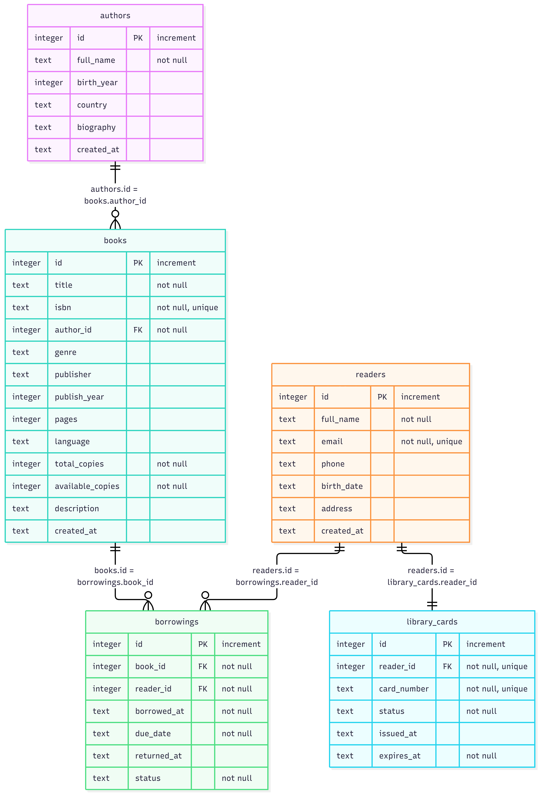
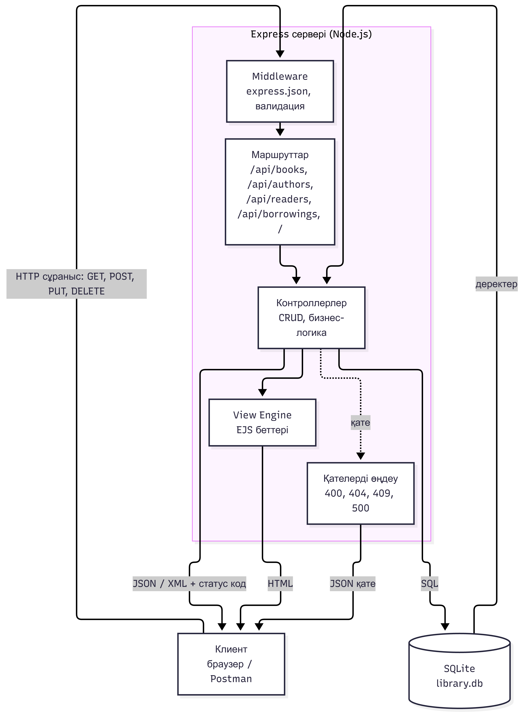

# Кітапхана ақпараттық жүйесі

«Веб-сервистерді әзірлеу» пәні бойынша СӨЖ №1.
Автор: Жұмәділ Темірлан

Кітаптарды, авторларды және оқырмандарды басқаруға арналған шағын веб-қызмет: REST API (JSON/XML), серверлік HTML беттер, SQLite деректер қоры.

## Технологиялар

- Node.js + Express: сервер және REST API
- SQLite (`better-sqlite3`): деректер қоры
- EJS: View Engine (серверлік HTML беттер)

## Орнату және іске қосу

Node.js 18+ қажет.

```bash
npm install
npm run seed     # деректер қорын жасау және тест деректерін толтыру
npm run dev      # сервер: http://localhost:3000
```

| Мекенжай | Сипаттама |
|---|---|
| http://localhost:3000/ | Басты бет (каталог, іздеу) |
| http://localhost:3000/books/1 | Кітап беті |
| http://localhost:3000/api/books | REST API |

## Архитектура

Клиент–сервер архитектурасы: клиент (браузер немесе Postman) Express серверіне HTTP сұраныс жібереді. Сервер сұранысты middleware (валидация) арқылы өткізіп, маршрутқа, одан контроллерге жібереді. Контроллер SQLite базасымен жұмыс істейді де, жауапты JSON, XML немесе HTML (EJS) түрінде қайтарады.



## Жоба құрылымы

```
src/
├── app.js                 # Express қосымшасы
├── db/                    # schema.sql, database.js, seed.js
├── routes/                # URI мен контроллерді байланыстыру
├── controllers/           # CRUD және бизнес-логика
├── middleware/            # валидация, қателерді өңдеу
├── utils/xml.js           # XML жауап жасау
└── views/                 # EJS беттері
public/style.css
docs/                      # диаграммалар, скриншоттар, Postman коллекциясы
```

## Деректер қоры

Бес кесте: `authors`, `books`, `readers`, `library_cards`, `borrowings`.

- `authors` → `books`: **1:M**
- `readers` ↔ `library_cards`: **1:1**
- `readers` ↔ `books`: **M:N** (аралық кесте `borrowings`)



## REST API

### Кітаптар

| Method | Endpoint | Мақсаты | Статус |
|---|---|---|---|
| GET | `/api/books` | Барлық кітаптар (`?search=`, `?genre=`, `?author_id=`, `?format=xml`) | 200, 400 |
| GET | `/api/books/:id` | Бір кітап (`?format=xml`) | 200, 400, 404 |
| POST | `/api/books` | Жаңа кітап қосу | 201, 400, 409 |
| PUT | `/api/books/:id` | Кітапты жаңарту | 200, 400, 404, 409 |
| DELETE | `/api/books/:id` | Кітапты өшіру | 200, 400, 404, 409 |

### Авторлар

| Method | Endpoint | Мақсаты | Статус |
|---|---|---|---|
| GET | `/api/authors` | Барлық авторлар (кітап саны бар) | 200 |
| GET | `/api/authors/:id` | Автор және оның кітаптары | 200, 400, 404 |
| POST | `/api/authors` | Жаңа автор қосу | 201, 400 |
| PUT | `/api/authors/:id` | Авторды жаңарту | 200, 400, 404 |
| DELETE | `/api/authors/:id` | Авторды өшіру | 200, 400, 404, 409 |

### Оқырмандар

| Method | Endpoint | Мақсаты | Статус |
|---|---|---|---|
| GET | `/api/readers` | Барлық оқырмандар (билет мәліметімен) | 200 |
| GET | `/api/readers/:id` | Бір оқырман | 200, 400, 404 |
| POST | `/api/readers` | Оқырманды тіркеу (билет автоматты жасалады) | 201, 400, 409 |
| PUT | `/api/readers/:id` | Оқырманды жаңарту | 200, 400, 404, 409 |
| DELETE | `/api/readers/:id` | Оқырманды өшіру | 200, 400, 404, 409 |

### Кітап беру және қайтару

| Method | Endpoint | Мақсаты | Статус |
|---|---|---|---|
| GET | `/api/borrowings` | Тізім (`?status=borrowed\|returned`, `?reader_id=`) | 200, 400 |
| GET | `/api/borrowings/:id` | Бір жазба | 200, 400, 404 |
| POST | `/api/borrowings` | Кітап беру | 201, 400, 403, 404, 409 |
| PUT | `/api/borrowings/:id/return` | Кітап қайтару | 200, 400, 404, 409 |

### Серверлік беттер (View Engine)

| Method | URL | Сипаттама |
|---|---|---|
| GET | `/` | Каталог, статистика, іздеу |
| GET | `/books/:id` | Кітап беті және алу тарихы |

## Валидация және қателерді өңдеу

| Жағдай | Статус | Мысал |
|---|---|---|
| Міндетті өріс толтырылмаған | 400 | `title` жоқ |
| Дұрыс емес дерек типі/форматы | 400 | `"pages": "көп"`, қате email |
| Қайталанатын мән | 409 | бар `isbn` немесе `email` |
| Ресурс табылмады | 404 | `/api/books/999` |
| Байланысты жазбалар бар | 409 | автордың кітабы бар кезде өшіру |
| Кітаптың бос данасы жоқ | 409 | беру кезінде |
| Бұзылған JSON | 400 | |

Қате жауабының форматы:

```json
{ "error": "Валидация қатесі", "details": [{ "field": "title", "message": "Міндетті өріс" }] }
```

## JSON және XML

Әдепкіде жауап JSON. XML алу үшін `?format=xml` параметрін немесе `Accept: application/xml` тақырыбын қолданыңыз:

```
GET /api/books?format=xml
```

## Скриншоттар

Postman нәтижелері және беттердің скриншоттары `docs/screenshots/` қалтасында, Postman коллекциясы `docs/postman/` ішінде.